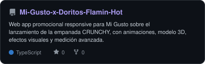
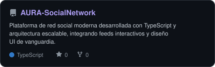
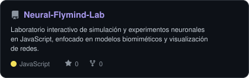
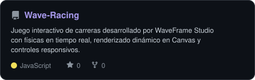
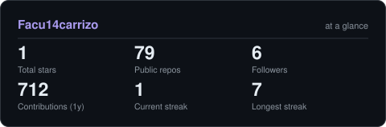

<!-- BANNER - terminal profile.sh --live -->
<picture>
  <source media="(prefers-color-scheme: dark)"  srcset="assets/banner-dark.v15.svg">
  <source media="(prefers-color-scheme: light)" srcset="assets/banner-light.v15.svg">
  
</picture>

 

<!-- NAME / TAGLINE - animated typing -->

 

<!-- SOCIALS & BADGES -->

---

## 🧑🏻‍💻 { About Me }

Hi, I'm **Facu Carrizo**, Full-Stack Developer & Software Builder, based in **Buenos Aires, Argentina** 🇦🇷.

Passionate about technology, cold coffee, and astronomy 🚀📡🪐. I focus on turning complex challenges into scalable, modern web applications, combining clean architectural principles with engaging, interactive digital experiences.

- 🛠️ **Specialty**: TypeScript, JavaScript, React, Next.js, Java, Spring Boot, Three.js, Node.js, and SQL.
- 🚀 **Featured Projects**: Interactive 3D planetary simulations, professional gaming and optical e-commerce platforms, music artist applications, and management systems.
- 📚 **Continuous Growth**: Advanced Cloud Architectures, WebGL / 3D Graphics, and High-Performance Backends.
- 💡 **Core Philosophy**: *"Transformando desafíos en código, y código en soluciones que impactan."*
- 💬 Talk to me about **Full-Stack development, 3D Web experiences, and modern software architecture**.

 

---

## 🚀 { Technologies and Tools }

---

## 🎯 { Skill & Stack Radar }

<table>
<tr>
<td width="50%" align="center" valign="middle">

<picture>
  <source media="(prefers-color-scheme: dark)"  srcset="assets/radar-dark.svg">
  <source media="(prefers-color-scheme: light)" srcset="assets/radar-light.svg">
  
</picture>

</td>
<td width="50%" align="center" valign="middle">

<picture>
  <source media="(prefers-color-scheme: dark)"  srcset="assets/radar-langs-dark.svg">
  <source media="(prefers-color-scheme: light)" srcset="assets/radar-langs-light.svg">
  
</picture>

</td>
</tr>
</table>

---

## 🌟 { Featured Projects }

<table>
<tr>
<td width="50%" align="center" valign="middle">

<picture>
  <source media="(prefers-color-scheme: dark)"  srcset="assets/card-Mi-Gusto-x-Doritos-Flamin-Hot-dark.svg">
  <source media="(prefers-color-scheme: light)" srcset="assets/card-Mi-Gusto-x-Doritos-Flamin-Hot-light.svg">
  
</picture>

</td>
<td width="50%" align="center" valign="middle">

<picture>
  <source media="(prefers-color-scheme: dark)"  srcset="assets/card-AURA-SocialNetwork-dark.svg">
  <source media="(prefers-color-scheme: light)" srcset="assets/card-AURA-SocialNetwork-light.svg">
  
</picture>

</td>
</tr>
<tr>
<td width="50%" align="center" valign="middle">

<picture>
  <source media="(prefers-color-scheme: dark)"  srcset="assets/card-Neural-Flymind-Lab-dark.svg">
  <source media="(prefers-color-scheme: light)" srcset="assets/card-Neural-Flymind-Lab-light.svg">
  
</picture>

</td>
<td width="50%" align="center" valign="middle">

<picture>
  <source media="(prefers-color-scheme: dark)"  srcset="assets/card-Wave-Racing-dark.svg">
  <source media="(prefers-color-scheme: light)" srcset="assets/card-Wave-Racing-light.svg">
  
</picture>

</td>
</tr>
</table>

---

## 📊 { Github Stats & Activity }

<picture>
  <source media="(prefers-color-scheme: dark)"  srcset="assets/card-stats-dark.svg">
  <source media="(prefers-color-scheme: light)" srcset="assets/card-stats-light.svg">
  
</picture>

 

---

*Thanks for visiting! Let's build solutions together that really make a difference! 💫*

 

` Built with passion · Facu Carrizo · WaveFrame Studio `

